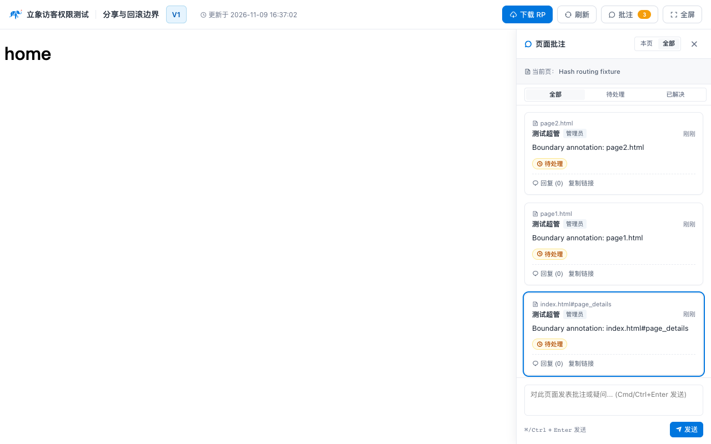
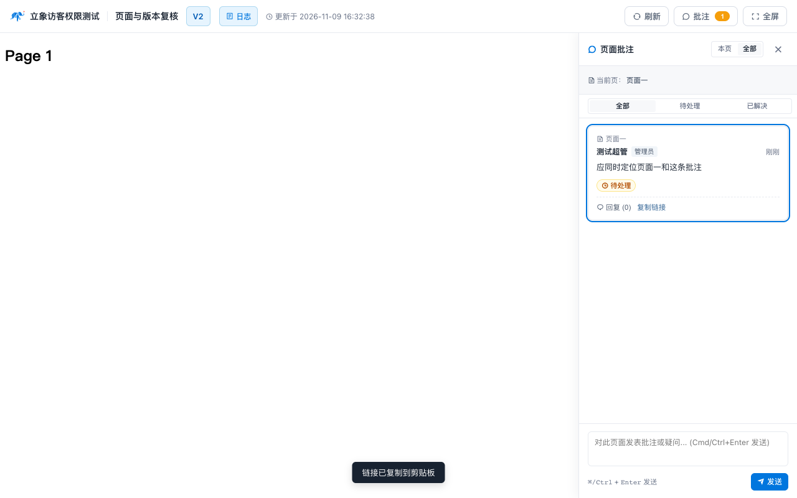

# Gemini 第二轮修复复核 · 2026-11-09

## 结论

上轮 R1—R5 的五个具体复现场景已通过。现有 20 套回归（可识别 674 项断言）、26 项真实浏览器检查也通过。

**仍确认 3 项 P2 边界问题、1 项 P3 时区遗漏，不能把“上轮例子通过”写成所有修复已经收尾。** P2 涉及分享 hash 页定位、过期请求覆盖当前页面、RP 恢复失败后删除旧备份；P3 是历史版本在分享页仍按当前夏令时偏移显示。

本轮只做审查与测试，没有修改业务源码、工作区运行数据或部署站点，没有提交 Git。

## 本轮范围

- 基线仍是 `0c6f11a` 之上 Gemini 的未提交差异，共 8 个业务文件，267 行新增、71 行删除。
- 与上轮复核保存的 SHA-256 相比，实际更新的是 `admin.js`、`app.js`、`includes/actions/versions.php`、`includes/auth.php`、`includes/modals.php`、`share.php`；批注 JS 与批注处理器沿用上一轮修复。
- 复核开始保存本轮 8 个文件哈希，结束再次核对，期间业务源码没有变化。
- 检查了新增的 RP 状态回执、首次 RP 回滚标记、分享深链取目标及页面切换、日志按历史时刻换算、外链负责人热同步。

## 仍需收敛

### N1 · P2 · K1：恢复旧 RP 失败时，finally 仍会删除唯一备份

- 位置：`includes/actions/versions.php:291`—`300`。
- 条件：已经把新 RP 放入正式路径，随后数据库失败；尝试把旧备份恢复到正式路径时，文件系统 rename 也失败。
- 代码问题：`@rename($backupDest, $destFile)` 没有检查结果；无论恢复是否成功，finally 都执行 `@unlink($backupDest)`。
- 实际验证：仅在一次性副本中给版本处理器增加测试命名空间，正常文件调用仍委托真实 PHP 文件函数，仅令“旧备份→正式 RP”的恢复 rename 返回 false；再用 SQLite 失败触发器模拟数据库更新失败。确认故障分支实际到达后，接口返回失败、备份数为 0、原字节已不在正式文件或备份中。随后真实下载接口返回 200，内容是本次已经报告失败的新 RP。
- 影响：错误恢复路径会主动删掉最后一份旧底稿。此项是双重故障注入结果，不能描述为普通更换都会丢文件；正常替换、已有 RP 的常规数据库失败恢复、首次补传失败清理本轮均通过。
- 建议：检查恢复结果；仅在成功提交或确认恢复成功后清理旧备份。恢复失败时保留原文件副本，不能在 finally 中无条件删除。
- 证据：`K1_restore_failure_preserves_backup`：`restore_failure_reached=true`、`original_bytes_preserved=false`、`backup_count=0`、`download_http=200`、下载为失败的新 RP。

### N2 · P2 · 分享定位忽略同一 HTML 内的页面 hash

- 位置：`share.php:1326`—`1328`。
- 复现：原型入口 `index.html` 支持 hash 页面，批注保存为 `index.html#page_details`，后端正确生成 `/asset.php/v1/index.html#p=details`。访问带该批注 ID 的分享链接，卡片正确高亮，iframe 的实际 hash 仍是空字符串，页面继续显示首页。
- 原因：新代码只比较两个 URL 的 `pathname`。路径相同就不导航，丢弃了 hash。现有 `annotation.js` 明确会存储 `#page_...`，`PrototypeContext::pageParts` 也明确支持它，属于已支持的数据路径。
- 影响：上一轮“index.html → page1.html”的普通页面定位已修复；Axure/同一 HTML 下依赖 hash 的页面仍无法定位到批注上下文。
- 建议：按实际页面标识比较目标，至少包含 pathname 与有效 hash，同时保留现有页面 hash 转换约定。不要把缓存参数误当成业务页面标识。
- 证据：`shared_same_file_fragment`：期望 `#p=details`，实际 `''`，批注卡片已聚焦。

### N3 · P2 · 新增异步定位缺少过期请求保护

- 位置：`share.php:1308`—`1334`，尤其 fetch 的响应回调。
- 复现：在同一授权版本内，先定位批注 A（page1），再定位批注 B（page2）。测试仅延迟 A 的真实接口响应，让 B 先返回：页面先正确到 page2；A 随后返回，又把 iframe 切到 page1，地址栏却仍是 `#annotation=B`。
- 原因：回调检查项目和版本，但没有检查请求序号或当前 hash 是否还是该请求的目标。旧、新请求在同一个项目/版本时均通过现有检查。
- 影响：网络抖动、快速切换链接或浏览器历史导航时，页面与当前批注不一致。此项是本轮新增异步分支的状态回退，未观察到权限扩大。
- 建议：处理成功、失败和降级聚焦前均确认请求仍是最新目标；可沿用工作台的请求快照/序号规则，或中止已失效请求。
- 证据：`shared_out_of_order_navigation`：当前 hash 为 `#annotation=3`，先到 page2，旧响应后却回到 page1。

### N4 · P3 · R4 仅修了日志，分享历史版本仍差一小时

- 位置：`share.php:296`—`297`；相关统计仍在 `includes/modals.php:553`—`557` 等处使用 `Auth::getTimezoneOffset()`。
- 复现：站点选择 `America/New_York`，同一版本的 UTC 更新时间设为 `2026-10-20 12:00:00`。工作台正确显示当地 `08:00:00`，分享页仍显示 `07:00:00`。
- 原因：日志已改用 `toLocalTime` 按发生时刻换算，但分享页 SQL 仍统一应用“现在”的时区偏移。统计 SQL 亦仍采用同一做法；本轮没有逐个验证统计图分桶。
- 影响：使用有夏令时的站点时区时，同一历史版本在不同界面显示不同时间。默认上海/新加坡时区不受这个一小时差值影响。
- 建议：分享版本展示复用按发生时刻转换的约定；统计按对应时刻或站点日界线转换，不把当前偏移应用到所有历史记录。
- 证据：`historical_version_site_share_time`：`workbench_correct=true`、`share_correct=false`，分享页命中旧偏移时间。

## 上轮问题的复核结果

| 上轮项 | 本轮实际结果 |
| --- | --- |
| R1：RP 操作后跳回 UTC | 通过。`16:32:34 → 16:32:38`，只增加 4 秒，不再倒退 8 小时；回执使用服务端更新时间 |
| R2：普通分享链接只聚焦卡片 | 普通跨文件页面通过，iframe 正确到 `page1.html`，卡片聚焦；进一步的 hash 和请求顺序问题见 N2/N3 |
| R3：首次补传失败留孤儿文件 | 通过。数据库失败后 `rp_file=''`，正式 RP 文件不存在；恢复本身也失败的情况见 N1 |
| R4：历史日志夏令时差一小时 | 原日志场景通过，`2026-10-20 08:00:00`；分享版本与统计仍见 N4 |
| R5：外链改名不热同步 | 通过，顶部从原姓名同步为“改名后的负责人”；普通版本仍按版本快照保护 |
| K1 正常 RP 更换 | 通过，真实下载字节为本次上传内容 |
| K1 已有 RP 的数据库失败 | 返回失败，旧字节和原元数据恢复，备份数为 0 |
| K1 在途请求/版本代际变化 | 受控请求被拒，当前代际的文件、大小元数据保持一致；仍返回通用服务端异常，未据此宣称所有并发组合都已验证 |
| 分享短码与口令 | 复制保留原短码和批注 ID；固定 V2 范围仍不能取 V1 批注，带批注 hash 的口令链接仍要求先验证口令 |
| 已修功能回退 | 20 套原回归和 26 项原版本管理浏览器检查通过；未发现同名覆盖、版本署名、角色权限或 RP 正常操作回退 |

## 本轮实际执行

| 检查 | 结果 |
| --- | --- |
| `python3 -B .dev/tests/run_all_tests.py` | 20/20 套件通过，可识别 674 项断言，42.64 秒 |
| `version_modal_browser.py` | 安装的 Chrome，1440×1000 / 390×844，26 项通过，pageerror 0 |
| `release_fix_recheck_20261109.py` | 上轮 5 个具体场景符合修复预期；含正常 RP、数据库失败与受控在途请求 |
| `release_fix_round2_20261109.py` | 定点复现 N1—N4；JSON 记录实际结果，脚本退出成功不代表这些场景符合产品预期 |
| PHP 语法 | 27 个 PHP 文件通过 `php -l`；实际运行时 PHP 8.3.20 |
| JS 语法 | 5 个非压缩业务 JS 通过 `node --check` |
| `git diff --check` | 通过，上轮行尾空格已清理 |

命令（在项目根目录）：

```sh
python3 -B .dev/tests/run_all_tests.py
python3 -B .dev/tests/version_modal_browser.py \
  --php /tmp/jinshi-php-common/php \
  --playwright-module /path/to/playwright
python3 -B .dev/tests/release_fix_recheck_20261109.py \
  --php /tmp/jinshi-php-common/php \
  --playwright-module /path/to/playwright
python3 -B .dev/tests/release_fix_round2_20261109.py \
  --php /tmp/jinshi-php-common/php \
  --playwright-module /path/to/playwright
```

原始结果在 `.dev/tmp/recheck2-20261109-*.log`；截图在 `.dev/screenshots/release-fix-round2-20261109/`，关键截图另保留在本报告同名目录。Browser plugin not available，沿用已有 Playwright/Chrome。新增测试只使用合成原型、本机服务、临时数据库和临时源码副本，不发送 Webhook。临时站点和故障注入均已清理。

未在 PHP 7.0 实机、生产 Apache/Nginx、真实大型 Axure 包全量交互或真实 Webhook 送达环境验收；本轮 hash 用合成 HTML 验证宿主的既有 URL 约定。保护备份的测试是明确的恢复 rename 故障注入，不能误写成自然生产事故。

## 截图

同一 HTML 的 hash 目标仍停在首页：



上轮普通跨文件页面定位已经恢复：


