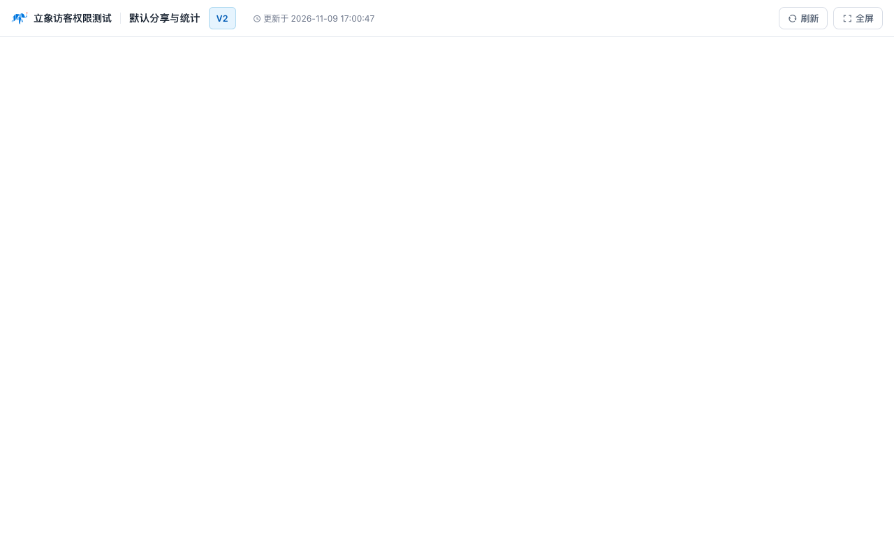

# Gemini 第三轮修复复核 · 2026-11-09

## 结论

**本轮引入 1 项 P1 回退：默认原型分享页的 iframe 地址重复包装，访客直接打开与管理员切版均为 404，原型区域空白。应修复后再定版。**

上一轮的旧 RP 备份保护、hash 页面定位、过期定位响应覆盖三项 P2 复现场景均已通过；分享页历史版本时间也已按发生时刻正确转换。仍有已登记的 P3：夏令时地区的历史日统计分桶未统一。

本轮没有修改业务源码或工作区运行数据，只新增定点复核脚本、报告和截图；未提交、未部署。

## 本轮实际差异

- 基线仍为 `0c6f11a` 之上的累计未提交差异，8 个业务文件、295 行新增、71 行删除。
- 对照上一轮保存的文件哈希，**这次仅 `includes/actions/versions.php` 与 `share.php` 更新**。其他 6 个业务文件保持上一轮状态。
- 复核前后核对 8 个文件 SHA-256，复核期间未变化。
- `versions.php` 新增恢复失败时保留旧备份的标记；`share.php` 新增定位请求序号/hash 快照、hash 页面比较，并改用 `versionForClient` 格式化分享版本行。

## P1 · 默认分享预览地址重复拼接，打开与切版均空白

位置：`share.php:299`—`300`、`:570`、`:720`，对照 `includes/auth.php` 中 `versionForClient` / `assetUrl` 的契约。

实际复现（合成原型，临时安装，Chrome 与真实 HTTP）：

| 场景 | 实际结果 |
| --- | --- |
| 未登录访客打开普通分享链接，不带 annotation hash | iframe src 为 `/asset.php/v2//asset.php/v2/index.html`，HTTP 404，原型区域空白 |
| 相同访客会话直接请求正确资源 `/asset.php/v2/index.html` | HTTP 200，内容包含合成原型 `Proto Home`；存储与分享授权本身正常 |
| 管理员打开分享页 | 同样的重复 iframe 地址，HTTP 404 |
| 管理员切换到 V1 | 地址变成 `/asset.php/v1//asset.php/v1/index.html?t=…`，仍为 404 |

根因：

1. 新代码对数据库版本行调用 `Auth::versionForClient($v)`。该函数除格式化时间外，还把 `entry_file` 从相对文件名 `index.html` 改成已完成鉴权包装的 `/asset.php/v2/index.html`。
2. 分享页后续仍把该行当作原始数据库行，在 iframe 和版本 option 中再次调用 `Auth::assetUrl()`。
3. 已包装 URL 被当作相对路径，再套一层 `asset.php/v…`，得到带双斜线的错误地址。

影响：普通外发预览主流程被阻断。带批注的深链会在接口响应后把 iframe 改为 `annotation_target` 返回的正确页面 URL，因此深链检查可以通过，同时掩盖默认分享页已失效；不能用深链通过代表普通分享入口正常。

最小修复方向：统一分享页的版本数据契约。可以只把原始行的时间字段交给 `toLocalTime` 转换、继续保留相对 `entry_file`；若保留 `versionForClient`，iframe 和所有版本 option 就应消费其已生成的 URL，避免再次调用 `assetUrl`。修复后至少验收：访客普通分享、管理员首次打开、管理员切版、带批注深链、子目录和嵌套入口。

证据：`release_fix_round3_20261109.py` / 同名 JS 的 `plain_guest_share`、`manager_share_version_switch`；单独真实 HTTP 探针也得到同样 404/200 对照。截图 `default-share-empty.png`。

## P3 · 夏令时地区的历史日统计仍归错日期

位置：`includes/modals.php:602`—`606`（30 天趋势），同类固定偏移用法还在其他统计 SQL 中。

实际复现：站点时区为 `America/New_York`，临时库只有一条 UTC `2026-10-20 04:30:00` 的合成访问日志。该时刻的当地日期是 **2026-10-20**；实际输出给趋势图的 `DASHBOARD_DATA.trend30d` 却是 **2026-10-19: 1**，20 日没有该次访问。

原因：统计仍用“现在”的 UTC 偏移平移所有历史记录，跨夏令时转换日时会错一小时，凌晨记录因而归到前一天。这是此前时区清单的残留，非本轮新引入；上海/新加坡这类无夏令时的站点配置不受该项影响。

建议：按历史时刻换算日期，或按站点日界线计算每个日期对应的 UTC 起止区间。分享页版本展示现已正确，不能据此把统计分桶也记为已修复。

证据：`historical_daily_bucket`，期望 `2026-10-20`，实际非零分桶为 `{"2026-10-19":1}`。

## 上轮复现场景状态

| 上轮项 | 本轮结果 |
| --- | --- |
| N1：恢复 rename 失败仍删除原备份 | 已修复备份保护。故障注入确实到达恢复失败分支，旧备份数 1，原字节保留，不再被 finally 删除 |
| N2：忽略页面 hash | 已修复原场景。目标 `#p=details`，iframe 实际 hash 也是 `#p=details`，批注正确聚焦 |
| N3：旧响应覆盖当前页面 | 已修复原场景。保持 `#annotation=3`，较晚返回的旧响应没有把 iframe 从 page2 切回 page1 |
| N4：分享历史版本时间差一小时 | 分享展示已修复，与工作台均按历史时刻显示 `2026-10-20 08:00:00`；统计分桶仍见上述 P3 |

K1 的双重故障测试只证明“旧备份没有丢”。当恢复 rename 本身被注入失败时，正式路径仍可能是本次失败的新文件，自动恢复尚未成功；保留备份不能描述成文件已经恢复。该故障状态下测试没有再把“旧备份保留”升级成新的回收站或文件恢复功能要求。

## 实际验证与边界

| 检查 | 结果 |
| --- | --- |
| 全量回归 `run_all_tests.py` | 20/20 套件通过，可识别 674 项断言，44.25 秒；现有套件未验证默认分享 iframe 的实际 src 可访问性 |
| 上轮定点复现 `release_fix_round2_20261109.py` | hash、请求顺序、备份保留和分享时间按上述表格恢复正常；诊断执行成功不等于整个产品验收通过 |
| 本轮默认分享与切版浏览器复核 | Chrome，访客 1280×800、管理员 1440×1000；页面框架可显示，实际 iframe HTTP 404，预览检查失败；JS pageerror 0 |
| 本轮日统计真实 HTTP | 解析实际输出给趋势图的 `trend30d` 数据，确认历史访问归到错误日期 |
| PHP 语法 | 27 个 PHP 文件通过 `php -l`，运行时 PHP 8.3.20 |
| JS 语法 | 5 个非压缩业务 JS 通过 `node --check` |
| `git diff --check` | 通过 |

本轮关键命令：

```sh
python3 -B .dev/tests/run_all_tests.py
python3 -B .dev/tests/release_fix_round2_20261109.py \
  --php /tmp/jinshi-php-common/php \
  --playwright-module /path/to/playwright
python3 -B .dev/tests/release_fix_round3_20261109.py \
  --php /tmp/jinshi-php-common/php \
  --playwright-module /path/to/playwright
```

日志在 `.dev/tmp/recheck3-20261109-*.log`；截图源在 `.dev/screenshots/release-fix-round3-20261109/`，关键截图另保存在本报告同名目录。Browser plugin not available，沿用已有 Playwright 与安装的 Chrome。所有测试仅使用临时站点、合成记录和本地服务，未发送真实 Webhook；临时环境结束后清理。

未做 PHP 7.0 实机、生产 Apache/Nginx、完整真实 Axure 交互、实际 Webhook 送达或用户最终验收。默认分享预览的 P1 是普通交互真实复现，K1 备份保护则是故障注入，两类证据不可混用。

## 截图

直接打开普通分享链接，框架正常、原型区域空白，iframe 实际请求 404：


