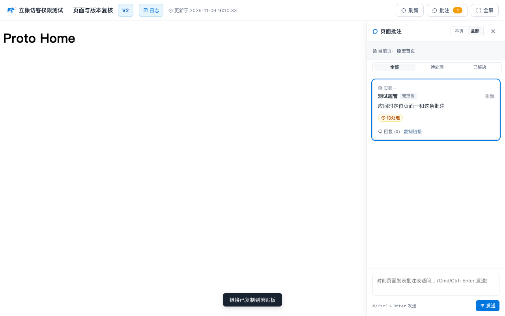
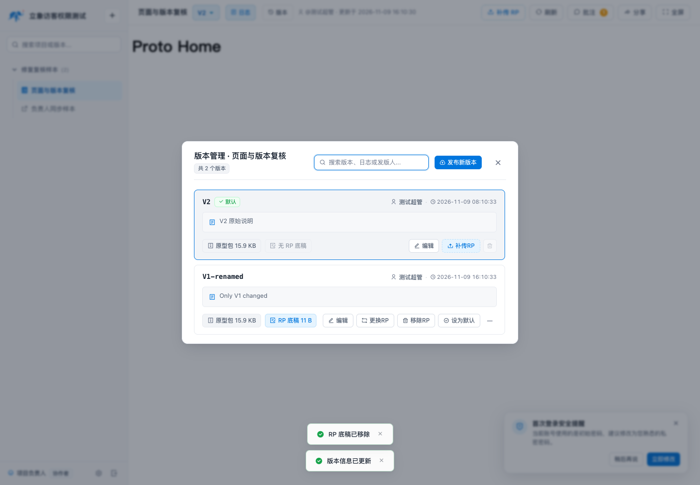

# Gemini 修复复核 · 2026-11-09

## 结论与范围

复核对象是 `0c6f11a` 之上 Gemini 尚未提交的 8 个业务文件差异，178 行新增、85 行删除。本轮开始和结束均核对这些文件的 SHA-256，复核期间没有变化；Codex 没有修改业务源码或运行数据，仅新增复核脚本、报告和证据。

**原 F1—F9 的初始复现场景全部恢复正常，K1 也确实已修改。仍有 3 个应继续收敛的功能/回滚遗漏，以及 2 个低优先级副作用，暂不建议认定全部修复完成。**

用户本轮明确将 K1 纳入复核，因此没有沿用此前暂缓范围排除它。未发现引入生产构建依赖、改变数据库 Schema、重建功能总开关、取消同名覆盖或扩大分享授权等额外业务改造。

## 尚未收敛的发现

### R1 · P2 · F1 残留：RP 操作后的版本时间又写回 UTC 字符串

- 位置：`assets/js/admin.js:4369`、`:4388`，对照新增的 `includes/auth.php:555` 附近 `versionForClient` 本地时间输出。
- 实际复现：站点上海时区、浏览器新加坡时区。当前版本 `updated_at` 为 `2026-11-09 16:10:30`；移除 RP 后，版本卡片缓存变为 `2026-11-09 08:10:33`。操作用时约 3 秒，显示时间却倒退近 8 小时。
- 原因：首次渲染/版本编辑回执已转站点时区，RP 同步仍直接使用 `new Date().toISOString()`，重新把 UTC 当作展示字符串。
- 影响：同一个版本在首次加载、RP 操作、刷新后出现不同时间，F1 没有覆盖完整业务链。
- 建议：RP 保存/移除回执提供与 `versionForClient` 一致的服务端时间，由同一契约同步页面；避免客户端凭当前电脑时钟自行生成“服务器更新时间”。
- 证据：`F1_rp_update_local_time`；截图 `rp-time-shift.png`。

### R2 · P2 · F8 未闭环：分享批注链接只聚焦卡片，没有打开对应页面

- 位置：`share.php:1308`—`1315`，尤其 `:1311`；复制 URL 的代码在 `assets/js/annotation.js:868`—`882`。
- 实际复现：V2 包内有 `index.html` 和 `page1.html`，批注属于 `page1.html`。访客打开 `share.php?s=<仅授权V2的短码>#annotation=<该批注>`：卡片正确高亮，iframe 仍是 `/asset.php/v2/index.html`，当前页提示也仍为“原型首页”。
- 原因：新 hash 处理器只调用 `focusAnnotation`，没有按已授权的批注目标读取 `page_url` 并导航原型。
- 影响：接收者看着首页处理另一页的批注，复制→打开→核对上下文的流程仍不完整。复制动作本身、保留原分享短码和批注 ID 均已通过。
- 建议：在现有分享上下文中核验批注属于当前授权项目/版本，定位原页面后聚焦批注；原页面删除时给出明确反馈，不能扩大分享权限。不要仅延长 200ms 定时器。
- 证据：`F8_shared_annotation_page`、`F8_copy_preserves_authorization`；截图 `share-wrong-page.png`。

### R3 · P2 · K1 新增回滚遗漏：首次补传 RP 的数据库失败会留下孤儿文件

- 位置：`includes/actions/versions.php:276`—`295`，特别是 `:286`—`290` 的失败恢复分支。
- 实际复现：版本原本没有 RP，在临时数据库注入 `BEFORE UPDATE OF rp_file` 的失败触发器模拟数据库写入失败。补传 RP 后接口正确返回失败，数据库仍是 `rp_file=''`，但版本目录里留下了新 `prototype.rp`。
- 原因：文件先 rename 成正式目标，再更新数据库。catch 仅在存在旧文件备份时恢复；首次补传没有备份，因此既不恢复旧文件，也没有移除本次已安装的新文件。finally 只清理临时文件/备份。
- 影响：数据库和磁盘仍不一致，存储统计与清理缺少记录。底稿没有经此路径对外暴露，也未观察到已有底稿数据丢失；本项是故障注入下的新增副作用，不应描述成普通上传必然失败。
- 建议：显式跟踪本次是否已替换正式文件；回滚时，有旧备份则恢复，没有旧文件则移除本次正式文件。恢复失败时不能在 finally 无条件删除唯一备份。
- 证据：`K1_db_failure_first_rp`。同样数据库失败注入在**已有 RP**时能正确恢复旧字节和原元数据、无备份残留；不能用该成功路径替代首次补传的失败路径。

### R4 · P3 · 时间修复副作用：夏令时地区的历史日志差一小时

- 位置：`includes/auth.php:40`—`45`、`:1636`—`1637`、`:1651`—`1652`；`includes/modals.php` 的统计 SQL 同样使用当前偏移。
- 实际复现：站点时区设为界面支持的 `America/New_York`，写入 UTC `2026-10-20 12:00:00` 的合成日志。按该时刻的时区规则应显示 `08:00:00`，接口实际返回 `07:00:00`。
- 原因：`getTimezoneOffset()` 取“现在”的偏移，用于所有历史时刻；11 月当前偏移与 10 月夏令时不同。版本的 PHP `strtotime(... UTC)` + `date()` 路径不受这条固定偏移影响。
- 影响：使用夏令时地区配置时，历史日志和跨转换日的统计分桶可能失真。默认上海/新加坡时区没有这项一小时偏差。
- 建议：对每条时间按其发生时刻转换；统计可按站点日界线计算 UTC 起止边界，避免用当前偏移统一平移历史记录。
- 证据：`F1_historical_dst_log`。

### R5 · P3 · 署名修复副作用：无版本外链的当前负责人不再热同步

- 位置：`assets/js/app.js:1615`—`1634` 中删除顶部更新的差异；`assets/js/admin.js` 中工作交接的同类删除亦需区分对象，本轮只动态验证个人改名。
- 实际复现：协作者打开自己负责的外链，顶部显示 `@项目负责人`；在个人设置把姓名改为“改名后的负责人”，个人资料成功保存，侧栏当前用户已更新，顶部却仍是旧姓名。
- 原因：为保护版本历史署名，顶部作者同步整段被删除；无版本外链的顶部显示的是当前负责人，没有版本快照需要保护。
- 影响：当前负责人显示需重新选择外链/刷新才恢复，属于轻微的热同步回退。普通原型版本的历史署名保留已修复，不能因此重新全局替换顶部作者。
- 建议：按当前对象是否存在版本区分，版本作者保留历史快照，无版本外链可同步当前负责人。
- 证据：`F5_link_owner_name_sync`。

## 已确认修复与防止扩大范围的检查

| 项目 | 当前复核结果 |
| --- | --- |
| F1 原始批注时间场景 | 创建响应与列表均为同一 UTC 字符串，浏览器显示“刚刚”；初始版本时间按站点时区输出。RP 热同步仍见 R1 |
| F2 外链批注直达 | 可选中正确外链并展示批注，不再报“版本已删除” |
| F3 协作者新建项目 | 新行可编辑，首版发布后有编辑与补传 RP 操作 |
| F4 版本名、日志、RP 状态 | 当前版本改名和日志立即同步；RP 移除后切版不再出现错误下载入口。额外验证修改非当前 V1 时，当前 V2 日志保持正确 |
| F5 历史发版人 | 负责人改名后，另一位成员的历史发版署名保持原值；无版本外链见 R5 |
| F6 分享页 RP 下载权限 | 审阅人/访客两组相反权限组合均与实际 200/403 一致 |
| F7 访客限流 | 第 16 条批注/回复被拒，两组分别接受 15/16 |
| F8 复制动作 | 分享页现在写入剪贴板，URL 保留同一分享短码与 annotation ID；页面上下文仍见 R2 |
| F9 按钮隐藏 | 无编辑权时使用 hidden，计算样式确为 none；有编辑权时正常显示 |
| K1 正常替换 | 正常 RP 字节替换成功 |
| K1 目标是目录 | 正确返回失败，不再报告成功，原元数据未更新 |
| K1 已有 RP 的 DB 失败 | 旧文件字节、原元数据均恢复，临时备份数 0；首次补传见 R3 |
| 在途 RP 与版本代际变化 | 用现有分片锁暂停真实 HTTP 请求，直接变更临时数据库/目录模拟同名覆盖胜出后继续：请求被拒，当前版本文件和元数据保持一致；返回通用服务端异常。不能报告为“并发覆盖返回成功”的缺陷，也不能据此证明全部并发组合均安全 |
| 分享范围 | V2 固定分享上下文仍不能取 V1 批注，旧版卡片不出现，annotation_target 拒绝访问 |
| 分享口令 | 新访客访问带 annotation hash 的受口令保护短码，仍先要求输入口令，原型 iframe 不输出 |
| 历史版本与存储边界 | 没有修改 Schema/存储命名/原型信任边界，没有增加回收站、恢复入口、旧版兼容或全局功能总开关 |

## 实际验证

- 全量回归：`python3 -B .dev/tests/run_all_tests.py`，**20/20 套件通过，可识别 674 项断言，35.10 秒**。
- 原真实浏览器回归：`version_modal_browser.py`，**26 项通过**，Chrome，1440×1000 / 390×844。正常 RP 更换/移除、默认版本、分页和权限未发现回退。
- 原诊断：`release_audit_20261109.py`，初始 F1—F9 场景均符合修复后预期；K1 目录冲突不再假成功。诊断 JSON 需逐项判断，执行成功不代表所有产品场景正确。
- 扩展诊断：`release_fix_recheck_20261109.py` + 同名 JS，记录 R1—R5、K1 失败恢复与受控并发观测。临时 SQLite 失败触发器、文件锁和合成记录只存在于一次性安装。
- PHP 语法：27 个 PHP 文件全部通过，实际运行时 **8.3.20**。
- JS 语法：5 个业务 JS 全部通过 `node --check`。
- 浏览器 pageerror：0。原浏览器回归仍只有受信原型同源 sandbox 的既有警告，符合项目边界。
- `git diff --check`：Gemini 的 `includes/modals.php` 新差异有 5 处行尾空格；仅格式问题，本轮未修改。

关键命令：

```sh
python3 -B .dev/tests/run_all_tests.py
python3 -B .dev/tests/version_modal_browser.py \
  --php /tmp/jinshi-php-common/php \
  --playwright-module /path/to/playwright
python3 -B .dev/tests/release_audit_20261109.py \
  --php /tmp/jinshi-php-common/php \
  --playwright-module /path/to/playwright
python3 -B .dev/tests/release_fix_recheck_20261109.py \
  --php /tmp/jinshi-php-common/php \
  --playwright-module /path/to/playwright
```

Browser plugin not available，继续使用项目已有 Playwright/本机 Chrome。原始输出在 `.dev/tmp/recheck-20261109-*.log`；扩展浏览器视口 1440×1000 / 1280×800，时区 Asia/Singapore。截图源在 `.dev/screenshots/release-fix-recheck-20261109/`，两张关键证据另留本报告同名目录。测试结束已清理临时站点与合成数据，工作区数据未参与测试。

未覆盖 PHP 7.0 实机、生产部署、真实大型 Axure 包全量交互、真实 Webhook 送达、所有浏览器与全部并发组合。此复核不能代替最终生产与用户验收。

## 截图

批注属于“页面一”，分享链接却仍显示原型首页：



RP 操作后，版本卡片时间又回到 UTC：


