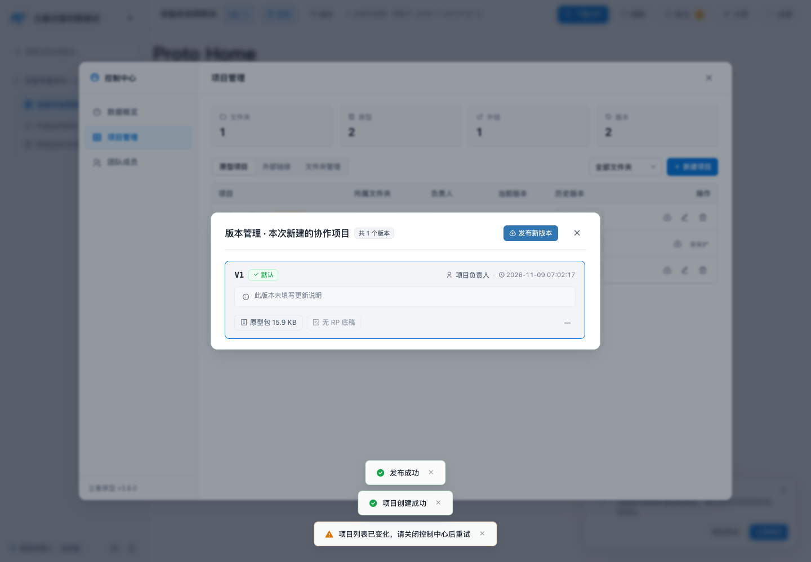
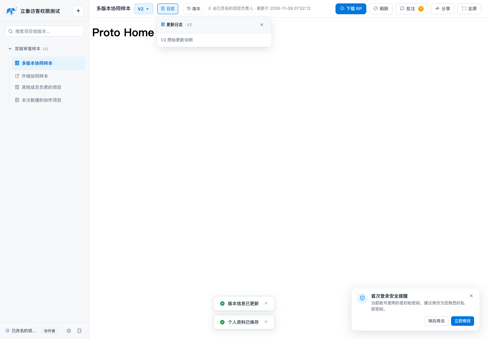

# 定版前代码与功能审查 · 2026-11-09

审查基线：`0c6f11ac8c7ac16d732e29834ae8c4fcce582b62`，开始时工作区干净。审查登录与角色鉴权、项目与版本发布、RP、分享、批注、MCP 的主要代码路径和跨页面交互。本轮没有修改业务源码、工作区数据库或部署环境，没有提交 Git。

结论：**确认 8 组 P2 功能问题、1 项 P3 按钮显隐问题**。现有测试通过，但未覆盖以下跨界面和失败路径；建议修复 P2 后再定版。另有此前明确暂缓的 RP 写失败一致性风险，单独登记，不能算本轮新发现。

## 确认问题

### F1 · P2 · 时间存储与显示混用 UTC 和本地时间

- 位置：`includes/db.php:235`、`includes/actions/annotations.php:256`、`assets/js/annotation.js:96`。版本和日志等表也使用 `CURRENT_TIMESTAMP`，页面多处直接展示该字符串。
- 复现：站点默认上海时区，浏览器设为新加坡时区。新增批注，提交响应返回 `15:xx:xx`，随后读取同一批注返回 `07:xx:xx`，差 8 小时；浏览器把刚创建的批注显示成「8 小时前」。
- 原因：SQLite 的 `CURRENT_TIMESTAMP` 是 UTC；PHP 的 `date()` 使用站点时区；前端又把无时区字符串按浏览器当地时间解析。
- 影响：发布/批注时间不准确，提交与刷新后显示跳变。控制中心按日期和小时聚合的 SQL 也直接使用 UTC 字符串，与 PHP 生成的本地日期标签不一致；跨午夜统计归类存在同源风险，未另行模拟午夜。
- 建议：统一存储和接口时间约定，接口携带时区或时间戳，再按站点/用户时区显示；统计分桶同时统一。仅改前端相对时间不能消除其余偏差。
- 证据：诊断 `annotation_timestamp`、`annotation_timezone_render`。

### F2 · P2 · 外链批注直达链接无法定位

- 位置：`assets/js/app.js:1152`—`1154`，对照 `includes/collaboration.php` 的无版本目标分支。
- 复现：为外链创建批注，登录后打开 `index.php#annotation=<批注ID>`。接口能够正确返回外链目标，但浏览器提示「版本已删除或不可访问」，停留在原先选中的原型项目。
- 原因：外链合法使用 `version_id=0`，工作台路由却一律要求在项目版本数组里找到匹配版本；外链的版本数组为空。
- 影响：外链批注的通知链接和内部直达路径断裂；批注本身没有丢失。
- 建议：路由按目标项目类型区分，外链无需匹配版本，选中对应外链后聚焦批注。不要把外部 URL 作为原型版本塞进 iframe。
- 证据：`link_annotation_deeplink`；截图 `link-annotation-route.png`。

### F3 · P2 · 协作者新建项目后被前端误判为无编辑权

- 位置：`assets/js/admin.js:1954`，消费方 `:3669`—`3670`、`:3850`。
- 复现：协作者在控制中心新建项目，保持控制中心打开，打开该项目版本管理并发布第一版。发布成功，但版本卡片没有「编辑」和「补传RP」；诊断中两个操作元素数量均为 0。刷新后从 PHP 重建项目行，权限恢复。
- 原因：新插入的项目行没有 `data-can-edit`，版本管理优先读取该行，令 `currentVerManageCanEdit=false`。管理员的角色兜底使问题在管理员测试里不出现。
- 影响：正常创建→发版→维护版本流程需要额外刷新；后端权限正常。
- 建议：新增行使用与首次 PHP 渲染相同的权限和元数据契约，创建者可编辑。检查新建行的作者、版本等状态字段，避免继续增加局部兜底。
- 证据：`new_editor_project_permissions`、`new_editor_project_after_publish`；截图 `new-editor-project.png`。

### F4 · P2 · 版本改名、日志与 RP 状态未同步到顶部版本下拉框

- 位置：创建 option 的 `assets/js/app.js:480`；更新方 `assets/js/admin.js:4094`、`:4410`。日志展示还依赖 `#topChangelogBody` 的缓存内容。
- 复现一：选中多版本项目的 V2，编辑成「V2-已修改名称」并更改日志；保存后顶部仍显示 V2，日志气泡仍是原始说明。
- 复现二：移除当前 V2 的 RP，切到 V1 再切回 V2，「下载RP」重新出现；实际下载返回 HTTP 404。
- 原因：option 只有 jQuery `.data('ver-id')` 缓存，没有 `data-ver-id` 属性；后续使用 CSS 属性选择器定位不到 option，版本名称、日志、RP 缓存保留旧值。日志内容也没有完整重绘。
- 影响：用户在正确保存后看到旧版本信息，或得到实际已不存在的下载操作；刷新可以恢复。
- 建议：统一 option 的数据写入/读取方式，并按当前实际查看的版本更新顶部名称、日志、底稿按钮。
- 证据：`rename_top_version`、`rename_top_changelog`、`removed_rp_reappears_after_version_switch`（按钮可见且 HTTP 404）；截图 `version-rename.png`、`rp-stale-option.png`。

### F5 · P2 · 修改姓名错误覆盖当前版本的历史发版人展示

- 位置：`assets/js/app.js:1633`—`1639`。交接热同步 `assets/js/admin.js` 中更新 `#barTime` 的逻辑存在相同的项目负责人/历史发版人混淆，后者本轮仅静态确认。
- 复现：协作者负责项目，管理员为它发布版本。顶部原本显示「@测试超管」。协作者在个人设置改名后，顶部变成「@已改名的项目负责人」，把另一位成员的发版署名改成了自己。刷新后恢复。
- 原因：根据项目的 `created_by` 判断应更新顶部作者，但顶部原本展示的是当前版本的 `author_name` 快照；两者可能不是同一人。
- 影响：历史责任人展示失真，违反版本署名不随改名/交接改变的约定。数据库署名快照没有被本次操作改写。
- 建议：项目负责人只同步负责人信息；版本作者始终由版本快照渲染。
- 证据：`historical_author_hot_sync`；截图 `author-snapshot.png`。

### F6 · P2 · 分享页 RP 下载按钮读取了错误角色的权限

- 位置：`share.php:43`，对照下载接口 `includes/actions/items.php` 的登录成员/访客鉴权分支。
- 复现一：允许审阅人下载、禁止访客下载。已登录审阅人在分享页没有下载按钮，但相同会话访问下载接口返回 200。
- 复现二：禁止审阅人下载、允许访客下载。已登录审阅人在分享页出现下载按钮，点击接口返回 403。
- 原因：视图使用 `canManage || canGuestDownloadRp`，漏掉已登录 viewer 的权限判断。
- 影响：有权限者缺入口，无权限者得到失败操作；本轮没有发现下载接口因此越权。
- 建议：按当前身份复用 `Auth::canDownloadRp`，在目标项目和版本确定后核验，与接口保持一致。
- 证据：两条 `share_download_permission`，实际 HTTP 返回分别为 200 / 403。

### F7 · P2 · 访客批注和回复的频率限制没有计数

- 位置：`includes/actions/annotations.php:193`、`:284`，对照 `includes/auth.php:902`—`928`。
- 复现：同一访客在一分钟内对同一外链发表 16 条批注，再对同一批注连续回复 16 条，全部成功；超过声明的每分钟 15 次限制仍未拦截。
- 原因：两个入口只调用读取计数的 `checkThrottle`，未记录/增加相同 scope 的次数。登录和分享口令流程有记录调用，不能据此证明批注已限流。
- 影响：持有合法分享访问的访客可以持续刷批注/回复、增长数据库；配置个人机器人时还会触发通知扇出。本轮未配置或发送任何真实 Webhook。
- 建议：对已接受的访客写入计数，使用同一窗口长度，并考虑并发情况下的原子累加。
- 证据：`guest_throttle`，批注 16/16、回复 16/16 被接受。

### F8 · P2 · 分享页批注的「复制链接」按钮无动作

- 位置：`assets/js/annotation.js:833`—`835`；`share.php` 只加载批注脚本，没有加载提供 `copyMcpText` 的 `assets/js/mcp.js`。
- 复现：未登录访客进入允许批注的分享页，展开批注抽屉，点击卡片「复制链接」。没有复制、没有成功/失败提示；浏览器捕获的剪贴板调用次数为 0，`copyMcpText` 为 undefined。
- 原因：复制实现依赖个人 MCP 面板的工具函数，且依赖不存在时静默返回。
- 建议：复制能力放入合适的公共层或提供分享页降级。另需让复制后的地址保留适用的分享上下文并定位确切批注，不能绕过原有授权，也不能把只能登录访问的地址当成访客可用直达链接。
- 证据：`share_annotation_copy`。这也是旧审查清单中仍未收敛的项目，本轮补充了真实浏览器复现。

### F9 · P3 · 无编辑权项目仍显示「发布新版本」

- 位置：`assets/js/admin.js:3675`、`includes/modals.php:157`、`assets/css/app.css:2155`。
- 复现：协作者打开其他成员负责、自己无共管权的项目版本管理。`can_edit=false`，按钮内联 `display:none`，计算样式却是可见的 `flex`（父 flex 布局将 inline-flex 块化）；点击后版本弹窗关闭，只提示「项目列表已变化，请关闭控制中心后重试」，上传弹窗没有打开。
- 原因：`.btn-sm` 的 `display:inline-flex !important` 覆盖内联显隐。现有 `[hidden]` 规则能真正隐藏，但该按钮没有使用 hidden。
- 影响：无效操作和错误的故障提示；不代表后端发布越权。F3 中头部发版按钮仍可见正是这条样式覆盖的附带结果。
- 建议：按项目既定约定使用真正的 hidden 状态；控制中心项目行的发布图标也应对齐权限。
- 证据：`read_only_project_publish_button`、`read_only_publish_click`。

## 已知且此前暂缓的风险

**K1 · P2 · RP 物理替换失败仍返回成功。** `includes/actions/versions.php:267`—`278` 先提交 RP 元数据，再忽略 `rename` 返回值，finally 还会移除暂存文件。仅在临时站点把目标路径改成目录，强制 rename 失败：API 仍 `success=true`，元数据记为 `prototype.rp` / 20 字节，实际下载 404。该测试是故障注入，不代表普通上传必然失败；正常更换路径的原回归通过。此前 [修复报告](2026-11-07-code-review-resolution.md) 明确记录用户暂不纳入 F4，本轮没有擅自修复或提升为新发现。RP 的最终写锁内权限/存储代际复核也仍弱于整包发布，本轮未模拟并发交接。

客户端水印的轻量威慑定位此前已经确认，未重新当成缺陷要求改造。

## 实际验证与边界

| 检查 | 实际结果 |
| --- | --- |
| `python3 -B .dev/tests/run_all_tests.py` | 20/20 套件通过，执行器可识别 674 项断言，36.00 秒；含真实临时 HTTP 与前端模拟 DOM，不能统称 674 个浏览器用例 |
| PHP 语法 | 根目录与 includes 共 27 个 PHP 全部通过 `php -l`；实际运行时 PHP 8.3.20 |
| JS 语法 | 5 个非压缩业务脚本通过 `node --check` |
| 版本管理真实浏览器原回归 | `version_modal_browser.py`，安装的 Chrome，1440×1000 / 390×844，26 项通过 |
| 额外版本编辑 HTTP 专项 | `version_edit_regression.py`，9/9 通过 |
| 干净源码 FTP 新装专项 | `ftp_layout_regression.py`，29 项通过。原工作区含运行数据，脚本按设计拒绝；改用当前 Git 跟踪文件的临时完整副本运行，未删除工作区数据 |
| 本轮诊断探针 | `release_audit_20261109.py` + 同名 JS，在临时合成安装复现 F1—F9 和 K1，输出 expected/actual；探针正常结束不等于产品正确性通过 |
| 本轮浏览器健康 | 已核对本地站点标题、有内容的工作台、表单/弹窗/路由和截图；应用脚本 pageerror 0 条。仅有受信原型 `allow-scripts + allow-same-origin` 的既有 sandbox 警告，符合项目边界 |

Browser plugin not available，沿项目已有 Playwright / Chrome 工作流执行；没有安装前端构建或生产依赖。诊断视口 1440×1000，分享页 1280×800，时区 Asia/Singapore。PHP 服务仅绑定 127.0.0.1，所有测试站点和合成数据在结束时清理；工作区运行数据未参与测试。

关键命令（在项目根目录）：

```sh
python3 -B .dev/tests/run_all_tests.py
python3 -B .dev/tests/version_edit_regression.py --php /tmp/jinshi-php-common/php
python3 -B .dev/tests/version_modal_browser.py \
  --php /tmp/jinshi-php-common/php \
  --playwright-module /path/to/playwright
python3 -B .dev/tests/release_audit_20261109.py \
  --php /tmp/jinshi-php-common/php \
  --playwright-module /path/to/playwright
```

原执行日志在 `.dev/tmp/audit-20261109-*.log`；本轮截图在 `.dev/screenshots/release-audit-20261109/`，均属于本机忽略产物。两张关键截图另保留在本报告同名资料目录，便于后续接手。

**未覆盖**：PHP 7.0 实机、真实 Apache/Nginx/FTP 生产站点配置、生产数据、大型真实 Axure 包及完整交互、官方 MCP SDK 本轮互通、真实 Webhook 送达、长时间负载/并发竞争、用户最终验收。FTP 测试路由器主动模拟私有目录拒绝规则，不能证明生产服务器已有相同保护。源码与本地检查结果不等于生产定版验收。

## 截图

协作者刚发布自己的第一版，卡片缺少编辑和补传 RP：



版本信息已经保存，顶部版本名与日志仍是旧值：


