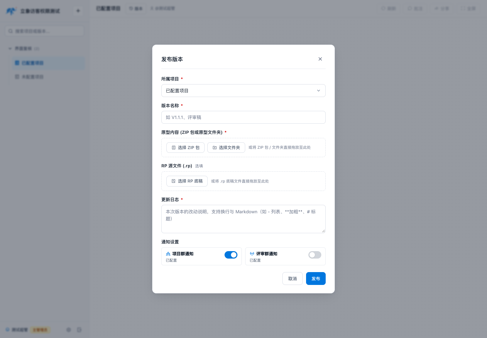

# 通知与心智问题修复复核 · 2026-11-09

## 结论

复核 `5dcc692` 上的当前未提交差异：6 个业务文件、2 个测试文件，共新增 224 行、删除 50 行。上一份审查记录及截图本来就是未跟踪文件，保留原状。

**尚有 2 项 P2：本次引入同一机器人地址重复发送；MCP 的默认静默仍未按用户确认规则修复。** 已修复通知选择保留、发送失败反馈、审批明确清空；已补开关标签和公共分享跟随默认版本的说明，版本卡片已复用安全 Markdown 渲染函数。

用户本轮前已明确确认“默认发送，允许取消”。没有收到把 MCP 默认改成静默的新指示；源码注释和测试预期不能代替这项产品约定。

本轮没有修改业务源码或对方的测试，没有提交、部署或发送真实群消息。

## R1 · P2：同一个机器人地址现在会重复发送

位置：`includes/actions/versions.php:161–179`。

项目群与评审群配置成完全相同的 URL，勾选两群发布一次：实际调用 `Webhook::send` **2 次**，预期 1 次。上轮代码对目标 URL 使用 `array_unique`，这次改为按 `item/global` 保存结果时去掉了去重。

影响：同一群收到两条相同发版通知；若两次结果不同，还可能在已送达后报告一个通道失败。

最小建议：按 URL 只发送一次，并把同一次结果分别映射回 `item/global` 的反馈；补回“同地址只发送一次”的测试。不要为了返回两份通道结果而实际发送两次。

## R2 · P2：MCP 只修了分群能力，默认仍与网页不一致

位置：`includes/actions/versions.php:57–70`；`includes/mcp_service.php:45`、`:219–221`。

真实 MCP HTTP 复测：

| 调用 | 实际结果 |
| --- | --- |
| 配置通知群、填写更新日志，省略通知参数 | 发布成功，发送 0 次 |
| `notify_item:false, notify_global:true` | 发布成功，只发评审群 1 次，结果包含 `global` |
| 两个参数显式为 false | 发布成功，发送 0 次 |

独立参数及布尔值传递已修复；缺省规则仍是静默。`versions.php:67` 还明确写成“外部 API / MCP 省略通知参数时默认静默”。这与已确认的“默认发送、可取消”不一致，不能把 M3 记作全部修复。

测试缺口：`.dev/tests/webhook_split_notify_regression.py:227–238` 把缺省预期改为“不产生推送”，所以套件通过没有证明产品规则满足。该段通过普通发布 API 验证，也没有真正调用 MCP。本轮另用实际 MCP 请求确认上述结果。

最小建议：统一缺省通知规则，同时保留显式 false 的取消能力；测试应断言用户确认的默认行为，并覆盖真实 MCP 入口。

## 上轮各项状态

| 上轮项 | 当前结果与证据 |
| --- | --- |
| M1：切换项目重开评审群 | 已修复。真实 Chrome：首次开启；手动关闭后切到无项目群项目、再切回均保持关闭；取消并重开弹窗后恢复默认开启 |
| M2：发送失败没有反馈 | 已修复接口反馈。模拟两群拒收时，版本仍保存成功，消息为“发布成功（项目群、评审群通知发送失败）”，两个 `notify_results.success` 均为 false；前端继续显示该消息 |
| M3：MCP 默认及分群不一致 | 部分修复：独立参数可用，缺省仍静默，见 R2 |
| M4：清空审批接收人反而全发 | 已修复。明确空数组后申请成功、发送 0 次；设置项真正不存在时，仍按初始规则通知管理员 1 次 |
| M5：分享目标版本不明确 | 部分修复。公共链接已增加“跟随项目默认版本”；专属链接创建处仍未说明版本跟随规则。本项本轮按代码核对，未重新做完整分享界面审查 |
| M6：跨页批注没有就地跳转 | 本次未修改该路径，仍登记为 P3 待处理 |
| M7：版本卡片 Markdown 不一致 | 代码已改用现有 `renderMarkdownSafe`，保留转义兜底；版本管理实际 Chrome 回归通过。本轮没有另做具体粗体样本的截图验收 |
| A1：通知开关无读屏名称 | 已修复。真实 Chrome 按“项目群通知”“评审群通知”分别能定位唯一 checkbox |

## 本轮实际验证

- `python3 -B .dev/tests/run_all_tests.py`：22/22 套件通过，可识别 691 项断言，68.25 秒。包含模拟 DOM 与真实 HTTP，不覆盖 R1，R2 的新增预期还偏离产品约定。
- `python3 -B .dev/tests/version_modal_browser.py --php /tmp/jinshi-php-common/php --playwright-module /path/to/playwright`：26 项通过，1440×1000 / 390×844，无业务脚本错误；保留已知的受信同源 iframe sandbox 提醒。
- 定点 Chrome：通知默认、切换后保留、重开后恢复、两个读屏名称均通过；390×844 下上传弹窗高 812px，内部可滚动。首次自动化未先悬停显示侧栏按钮而超时；按真实悬停路径重跑通过，没有绕过点击或强行调用页面函数。
- 临时 HTTP / MCP 探针：复现 R1、R2，验证 M2、M4 及 MCP 独立通知、显式静默；机器人传输均本地模拟，临时安装结束后清理。
- 4 个修改的业务 PHP、1 个修改的业务 JS 语法检查通过。`git diff --check` 未通过：`includes/actions/versions.php:61` 有一行行尾空白，属于格式收尾。
- 审查前后业务 PHP/JS/CSS 哈希一致，未覆盖并行修改。没有安装依赖或改动真实运行数据。

日志与探针在 `.dev/tmp/review-model-fix-20261109-*`；Browser plugin not available，沿用现有 Playwright 与安装的 Chrome 回归流程。运行时 PHP 8.3.20，未验证 PHP 7.0 实机、生产部署、真实机器人送达或完整真实 Axure 交互。

## 当前修复截图

用户关闭评审群后切换项目再切回，选择保持关闭；项目群仍正常可用：

