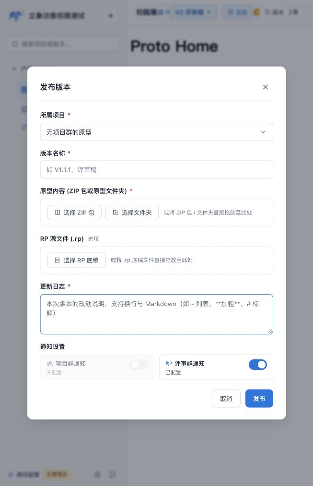
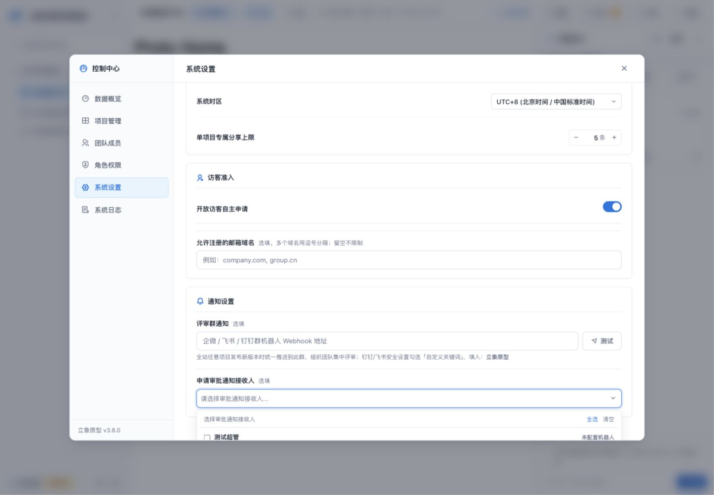

# 评审群通知与产品心智复核 · 2026-11-09

## 结论与约定

复核版本 `5dcc692`，开始时工作区干净。用户本轮确认：**所有项目发版默认通知系统配置的评审群，发布者可以取消本次通知；项目群与评审群独立控制。**

网页默认选择与服务端双群路由已符合该定位：无项目群仍可发评审群、两群并行、分别取消、全部取消、同一地址去重均通过。

仍有 4 项 P2 建议定版前处理；另有 3 项体验一致性建议及 1 项读屏标签缺口。M1 与本次双开关交互直接相关；其余为本轮扩大到通知结果、MCP 和协作心智后确认的现存不一致，不全部归为本次改动引入。

本轮只审查、创建临时测试环境和记录证据，没有修改业务源码、提交或部署，没有发送真实群消息。

## 实景审查路径

| 步骤 | 操作与总体状态 | 当前截图 |
| --- | --- | --- |
| 1 | 打开发版弹窗、取消评审群、切换项目：默认配置正确，但选择被重置；另核验 HTTP/MCP 的路由与失败结果 | [默认双群](2026-11-09-review-group-mental-model/01-publish-defaults.png)、[切换项目后](2026-11-09-review-group-mental-model/02-switch-project-reset.png) |
| 2 | 系统设置查看评审群与审批接收人、清空配置并重开发版：配置状态同步正确；审批空选择语义不符 | [审批接收人为空](2026-11-09-review-group-mental-model/10-approval-empty-recipients.png) |
| 3 | 版本管理查看同一份日志：发版人、默认版本和版本操作正常；日志格式与顶部不一致 | [版本日志](2026-11-09-review-group-mental-model/07-version-log-format.png) |
| 4 | 批注从“本页”切到“全部”、点击其他页面名称：范围表达明确，但缺少就地跳转 | [跨页批注](2026-11-09-review-group-mental-model/09-annotation-page-jump.png) |
| 5 | 切到历史 V1 后打开分享、查看创建专属链接、打开实际公共链接：资源正常，目标版本提示不明确 | [历史版本发起分享](2026-11-09-review-group-mental-model/12-share-from-historical-version.png)、[专属链接表单](2026-11-09-review-group-mental-model/13-custom-share-version-choice.png)、[实际打开 V2](2026-11-09-review-group-mental-model/14-public-share-actual-version.png) |

## 建议定版前处理

### M1 · P2：切换所属项目，覆盖了用户明确取消的通知

操作：打开发版 → 关闭“评审群通知” → 所属项目切换为“无项目群的原型”。实际评审群开关从 0 自动回到 1。它是全局目的地，换项目不应悄悄撤销本次取消选择，否则容易误发。

位置：`assets/js/admin.js:199`、`:244–250`、`:938`。`updateUploadNotifyState` 既负责可用性，又每次强制 `checked = true`。

最小建议：弹窗初始化时设置默认值；切换项目时更新可用性，保留用户本次主动选择。无配置的目标仍保持禁用和关闭。

### M2 · P2：群通知全部失败，结果仍只有“发布成功”

临时副本让两次实际 `Webhook::send` 均返回 `success:false`：版本成功保存，API 返回 `success:true`、`message:发布成功`，没有任何通知状态，前端也无法提示未送达。发布成功这个事实正确，但用户勾选的评审通知没有反馈，容易误以为团队已收到。

位置：`includes/actions/versions.php:167–173`；前端 `assets/js/admin.js:1116` 后消费该结果。

最小建议：保持版本发布成功，分别返回项目群、评审群的发送结果；有失败时显示“发布成功，评审群通知失败”等提示。避免把已保存的版本当作发布失败引导重发。

### M3 · P2：MCP 默认静默，且无法独立选择两群

实际 MCP HTTP 请求：配置两群后，`publish_version` 省略通知参数，版本发布成功、发送次数 0；显式 `notify_webhook:true` 才发送两次。`tools/list` 的发布参数只有 `notify_webhook`，没有 `notify_item` / `notify_global`，无法表达网页支持的“只通知评审群”。

位置：`includes/mcp_service.php:45`、`:213–219`；`includes/actions/versions.php:57–63`。

最小建议：统一网页和 MCP 的通知默认规则，为 MCP 暴露独立目标参数，保留显式取消语义。发布凭据与权限不需要扩大。

### M4 · P2：“清空审批通知接收人”实际变成通知全体管理员

界面有“全选 / 清空”，没有勾选时显示“请选择审批通知接收人”。后台却把空数组按“全部管理员”处理。临时安装保存空数组并给管理员配置模拟个人机器人后，新访客申请仍触发该管理员的 `user_apply` 通知。

位置：`includes/modals.php:1801–1808`；`includes/actions/auth.php:148–151`。

最小建议：区分尚未配置的默认行为与用户明确清空。初始可默认全选并如实展示；用户清空后应不发送。不要增加新的全站功能开关。

## 可一并收敛的细节

| 编号 | 观察与影响 | 最小建议与位置 |
| --- | --- | --- |
| M5 · P3 | 正在看 V1 时打开分享，表单只显示项目名；复制的公共链接实际打开默认 V2。专属链接创建表单也没有版本信息，前端未提交 `ver_id`，实际新记录为 0、跟随默认版本。用户容易把“分享项目”理解成“分享当前所看版本” | 在公共/专属链接处明确“跟随默认版本 · 当前 V2”。这项是目标表达问题，未发现权限扩大；不要求新增固定版本分享功能。`assets/js/share.js:24–32`、`:207–212`；`includes/actions/shares.php:113` |
| M6 · P3 | 批注“全部”里能看到其他页面的意见，但点页面名称无反应；仍停在原型首页，得复制深链另开才能回到目标页 | 为页面名称或“查看页面”复用现有确切批注定位能力。`assets/js/annotation.js:596–597` |
| M7 · P3 | 同一更新日志在顶部正确渲染粗体，版本卡片却显示原始 `**评审重点**`，与输入框“支持 Markdown”的预期不一致 | 版本卡片复用现有安全 Markdown 渲染函数。`assets/js/admin.js:3935`；对照 `assets/js/app.js:538` |
| A1 · P3 | 两个新增通知开关在可访问树中没有名称；相邻卡片标题没有关联到 checkbox，读屏难以区分两个开关 | 给输入添加指向各自标题的 `aria-labelledby` 或明确 `aria-label`。`includes/modals.php:122`、`:139`。这是确认的标签缺口，不等于完成全面无障碍审计 |

## 实际验证与限制

- `python3 -B .dev/tests/run_all_tests.py`：22/22 套件通过，可识别 685 项断言，61.93 秒；包含模拟 DOM 和真实 HTTP，不等于全部浏览器验收。
- `python3 -B .dev/tests/version_modal_browser.py --php /tmp/jinshi-php-common/php --playwright-module /path/to/playwright`：26 项通过，1440×1000 / 390×844，无业务脚本错误。
- 独立临时 HTTP 探针：两群、无项目群、仅项目群、仅评审群、静默、同地址去重 6 场景均正确；另真实复现 M2、M3、M4。网络传输在临时副本截获，不依赖真实群服务。
- 分享 HTTP 对照：未登录公共链接实际资源为 `/asset.php/v2/index.html`；按当前前端相同字段新建专属链接，数据库绑定版本为 0。
- 实景截图来自本轮 in-app Browser，初始窗口及 1440×1000 工作台尺寸；截图均保存并显示复核。临时页面、浏览器标签、测试数据已清理。
- 28 个业务 PHP 与 5 个非压缩业务 JS 语法检查通过，`git diff --check` 通过；审查前后业务 PHP/JS/CSS 哈希一致。
- 内嵌浏览器记录过一条来源未标明的 `MutationObserver.observe` 异常。业务中两处 observer 调用均有异常捕获；同一站点的普通 Chrome 登录页、分享页只读对照均无此异常，版本浏览器专项也无异常。当前未确认其来源，不把它当作已定位的产品缺陷，也不声称内嵌浏览器控制台完全无错误。

原始证据在 `.dev/tmp/review-model-20261109-*`；运行时 PHP 8.3.20。未验证 PHP 7.0 实机、生产部署、真实群送达、完整真实 Axure 交互或全部角色的屏幕阅读器体验。本报告是已检查路径的结论，不代表穷尽全站所有细节。

## 关键截图

手动关闭评审群后切换项目，评审群重新开启：

审批接收人显示未选择，并提供“清空”，实际空数组却触发全体管理员：

