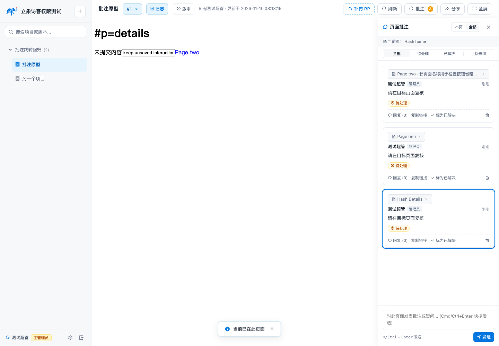
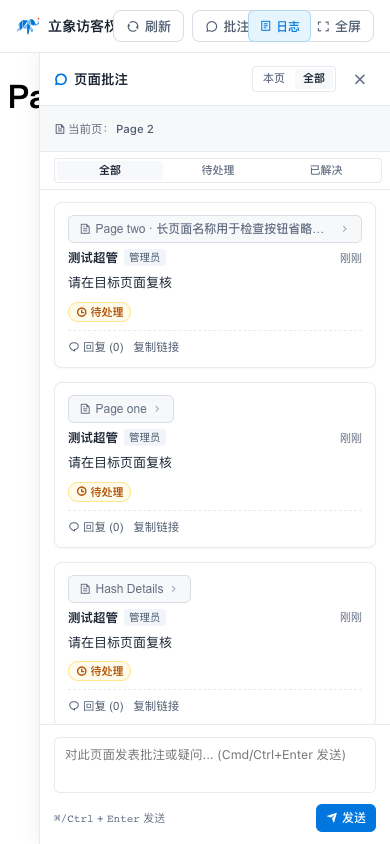

# 批注页面跳转修复与验证 · 2026-11-10

## 结果

工作台与分享页的批注页面入口现在按服务端返回的规范 URL 跳转，同一 HTML 内的 Axure hash 页面可以正确定位。相同页面不重载；仅变化 hash 时保留当前文档和未提交的交互内容。

连续点击时只接受最后一次请求。切换项目、版本或在原型中手动翻页后，之前的定位响应失效，不再覆盖 iframe、地址栏或批注聚焦。返回的项目与版本也会与当前上下文核对。

页面入口改为共享 28px 语义按钮，可用 Enter/Space 操作；颜色消费现有令牌，聚焦动效尊重减少动态效果偏好。目标页面不存在时只提示查看批注原文，不再误称已打开入口。

## 范围

- 保留并完善原有未提交的批注入口、样式及交互测试，只修改该功能相关文件。
- `assets/js/annotation.js`：规范目标、实际 iframe 地址比较、hash 导航、请求及上下文保护。
- `assets/css/app.css`：共享按钮规格、颜色令牌与减少动态效果。
- `.dev/tests/interaction_no_reload_regression.js`：同页、hash、乱序响应、上下文切换回归；增加异步测试完成保护，避免未完成就误报通过。
- 新增 `.dev/tests/annotation_jump_browser.py` / `.js`，并在 `.dev/README.md` 登记运行命令。
- 修复前的审查与截图继续保留，并标明已修复。没有改动分享授权、通知、后端存储或文件恢复规则。

## 实际验证

| 验证 | 结果 |
| --- | --- |
| 全量统一回归 | 22/22 套件通过，可识别 710 项断言，52.39 秒；含 HTTP、MCP 和模拟 DOM |
| 新增浏览器专项 | 44 项通过，超管、协作者、审阅人、未登录分享访客，无应用脚本错误 |
| 真实键盘/hash/同页 | Enter/Space 可用；hash 切换和重复点击保留未提交输入 |
| 真实乱序响应 | 两次点击的响应倒序返回，仍保持最后一次页面与批注路由 |
| 用户后续导航 | 手动翻页后旧响应失效；三个内部角色切换项目或版本后旧响应失效 |
| 窄屏长标题 | 390×844 下页面按钮不溢出批注抽屉；桌面为 1440×1000 |
| 语法与格式 | 业务 JS、新浏览器脚本语法检查及 `git diff --check` 通过 |

命令：

```sh
python3 -B .dev/tests/run_all_tests.py
python3 -B .dev/tests/annotation_jump_browser.py --php /tmp/jinshi-php-common/php --playwright-module /path/to/playwright
```

Browser plugin not available，沿用已有 Playwright 与安装的 Chrome，未安装依赖。PHP 测试运行时 8.3.20。HTTP 与浏览器均使用可清理临时安装及合成原型，结束后清理；没有发送真实群消息。原始日志在忽略的 `.dev/tmp/annotation-jump-fix-*`。

未做 PHP 7.0 实机、生产部署、真实群送达或完整真实 Axure 包验收；这些与本轮源码、自动化和浏览器证据分别记录。先前登记的专属分享版本跟随说明不在本次批注修复范围。

## 当前截图

hash 正确定位，输入框中的未提交内容仍然保留：



访客分享页窄屏下的长页面名称与键盘按钮：


