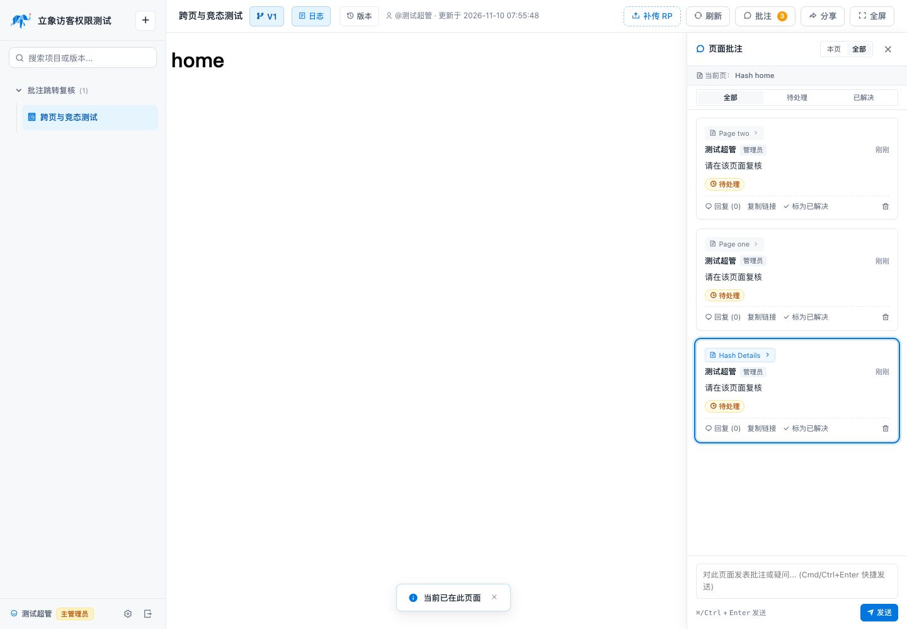
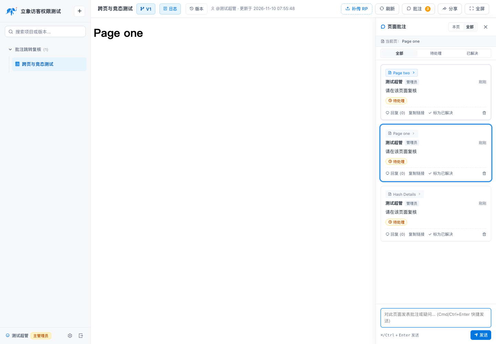
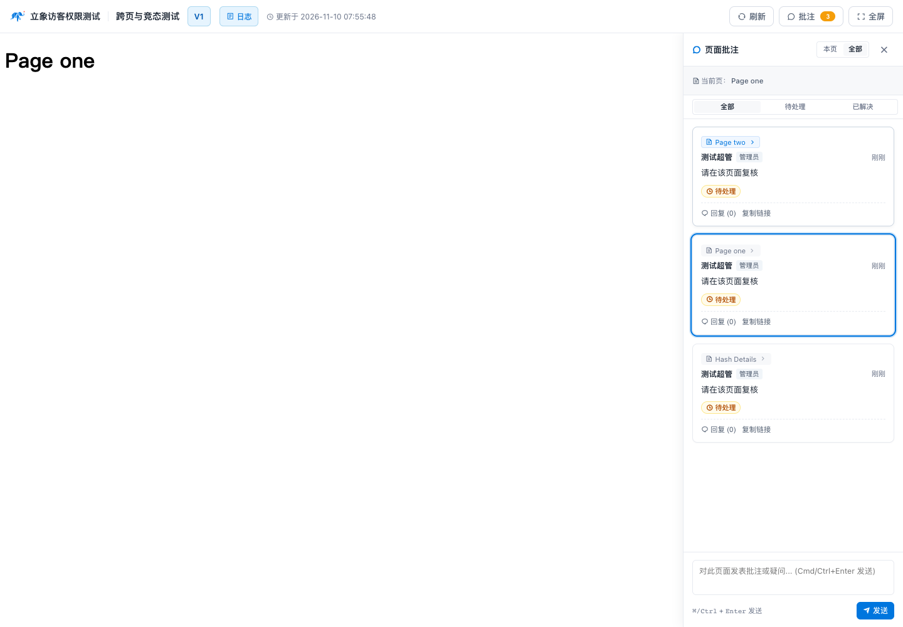

# 新增批注跳转复核 · 2026-11-10

> 后续状态：以下为修复前证据；两项 P2 及入口键盘/颜色规范问题已修复，见[修复与验证记录](2026-11-10-annotation-jump-fix.md)。

## 结论

通知修复已提交到 `ac5dcf2`。对照上轮业务文件哈希，当前新增业务差异仅为 `assets/js/annotation.js` 与 `assets/css/app.css`，配套修改了交互模拟测试。

**新增页面名点击入口能完成普通跨文件跳转，但有 2 项 P2：忽略 hash 导致 Axure 同 HTML 不同页面无法跳转；迟到的旧响应覆盖最后一次选择。工作台和未登录访客分享页均已实际复现。**

这是新增 `jumpToAnnotationPage` 路径的问题。原有 `share.php` 深链处理已有 hash 比较与请求序号保护，不能用原深链正常代表新入口也正常。

本轮未修改业务源码、对方测试或真实运行数据，未提交、未部署，未发送真实消息。

## J1 · P2：同一 HTML 内不同 hash 页面被误判为当前页

位置：`assets/js/annotation.js:879–887`。

实际操作：原型停在 `index.html` 首页，批注目标为 `index.html#page_details`；点击批注卡片的 “Hash Details” 页面名。

结果：iframe 仍在首页、hash 为空，提示“当前已在此页面”；`annotation_target` 请求次数为 0。正确目标应为服务端规范化得到的 `index.html#p=details`。

原因：同页判断对目标和当前路径都执行 `replace(/#.*$/, '')`，把 Axure 页面 hash 删除后再比较。相同 HTML 文件不等于相同原型页面。

最小建议：以 `annotation_target` 返回的规范页面 URL 与实际 iframe 地址比较，保留 hash，复用已有 Axure hash 解析规则；只有确实处于同一目标页面时才跳过导航。不要仅比较去掉 hash 的路径。

## J2 · P2：连续点击时，旧响应把新页面切回去

位置：`assets/js/annotation.js:892–923`。

实际操作：点击 page1 的批注并延迟其定位响应，随后点击 page2。page2 先返回，iframe 正确显示 page2；放行 page1 的旧响应后，iframe 又被切到 page1，地址栏也回到旧批注 `#annotation=2`。

工作台和访客分享页结果相同。此次只是延迟浏览器接收真实接口响应，没有伪造目标 URL，也没有修改业务脚本。

原因：新函数没有请求序号与上下文快照校验，任何较晚返回的成功响应都能改 iframe、路由和聚焦状态。

最小建议：增加递增请求序号和项目/版本上下文快照，只允许最新且仍属于当前上下文的结果执行导航与聚焦。参考现有 `share.php:1312–1327` 的处理，同时核验响应的项目/版本，防止用户已切换项目时旧结果仍生效。

## 局部规范收尾

- 新页面入口是带 `onclick` 的 `div`，实际 DOM 为 `role:null, tabIndex:-1`，不能作为正常按钮通过键盘聚焦和激活。建议使用语义按钮，复用项目按钮基础类和尺寸类。位置：`assets/js/annotation.js:598`。
- `.anno-page-link:hover` 新增了 `#f0f7ff`、`#d0e3fc`；聚焦动效也直接写入颜色。应消费已有 `--primary-soft`、`--primary-border`、`--primary-ring` 等令牌。位置：`assets/css/app.css:3996–4027`。

## 实际验证

| 场景 | 工作台 | 未登录分享页 |
| --- | --- | --- |
| 不同 HTML 文件间点击跳转 | 通过，实际到达 page1 |
| 同 HTML、不同 hash 页面 | 失败，留在首页，未请求目标接口 |
| 连续点击、旧响应迟到 | 失败，从 page2 被切回 page1，路由也回退 |

- `python3 -B .dev/tests/run_all_tests.py`：22/22 套件通过，可识别 707 项断言，42.36 秒。新增模拟测试只覆盖普通同页和普通跨文件，没有覆盖本报告的 hash 与响应乱序场景。
- 定点真实 Chrome：1440×1000，两类身份各 3 个观察场景；功能结果见表，应用脚本错误为 0。进程成功退出不等于上述业务观察都通过。
- `node --check assets/js/annotation.js` 与 `git diff --check` 均通过；审查前后业务 PHP/JS/CSS 哈希一致。
- Browser plugin not available，沿用现有 Playwright 与安装的 Chrome。测试只在可清理临时安装、合成 HTML 与批注上运行，临时数据结束后清理。
- 原始证据：`.dev/tmp/review-model-fix-20261110-round3-tests.log`、同前缀 `-browser.json`；临时驱动脚本也在忽略的 `.dev/tmp/`，未写入业务目录。
- 未重新进行完整移动端、真实 Axure 包、PHP 7.0 实机、生产部署或真实群送达验收。服务端通知代码未变化，现有通知回归仍通过。专属分享版本跟随说明仍是先前登记的 P3，本次未改动该路径。

## 当前截图

点击 “Hash Details” 后卡片已聚焦，但原型仍是 home，并提示“当前已在此页面”：

用户最后点击的是 Page two，旧响应返回后却显示 Page one：

访客分享页同样出现旧响应覆盖：

